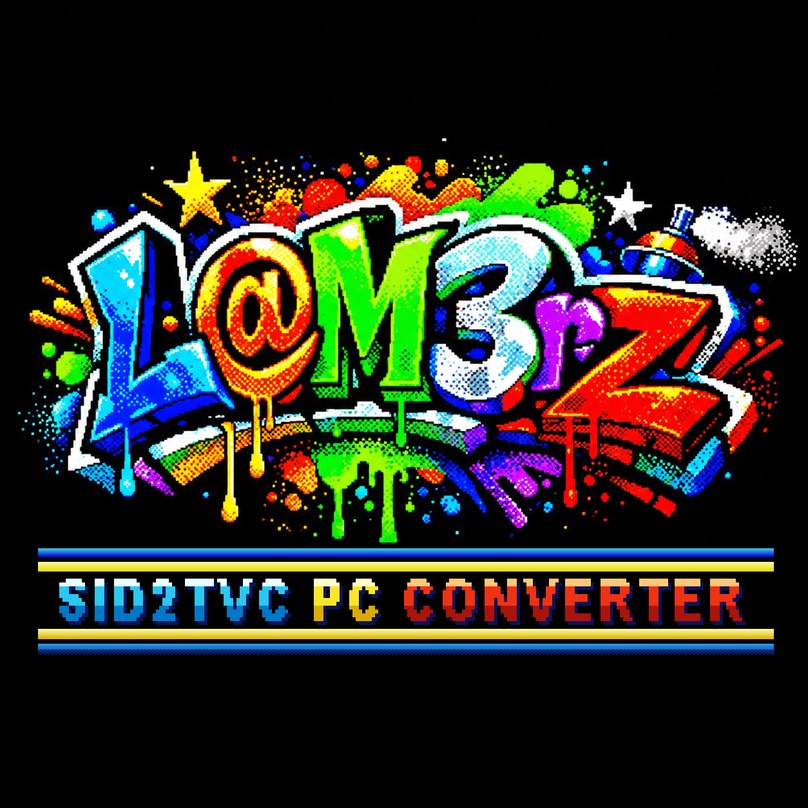

# SID2TVC Converter 1.4.1



**C64-es SID-zenéből TVC-zene – a PC-n.**

A `sid2tvc` elvégzi mindazt, amihez sok számolás kell: lefuttatja a C64-es zenét, kiszámolja, hogyan szólna a SID, és
elkészíti belőle a TVC-nek való, tömörített dalt. A TVC utána már csak lejátssza. Egy program, három feladat:

| Mit | Parancs | Kinek |
|---|---|---|
| **SID → STC** | `sid2tvc zene.sid` | a [SIDSoftEMU](../SIDSoftEMU/) lejátszónak (`.STC` dalfájl) |
| **SID → BIN** | `sid2tvc -b -s 1 zene.sid` | a [SID2TVC TRSE Unit](../SID2TVC_TRSE_Unit/)-nak (saját programba, játékba) |
| **STC → BIN** | `sid2tvc -b SONG1.STC` | ugyanaz egy kész `.STC`-ből |

Ingyenes `.sid` zenék tízezrei: [High Voltage SID Collection (HVSC)](https://www.hvsc.c64.org/).

## Mi kell hozzá

Csak a gépednek megfelelő program – nem kell hozzá semmi más. Mindegyik ugyanaz a program, és bájtra ugyanazt adja.

| Rendszer | Mappa | Megjegyzés |
|---|---|---|
| Windows, 64 bites | [`windows-x64/`](windows-x64/) | Windows 7-től; ARM-os Windowson is fut |
| Windows, 32 bites | [`windows-x86/`](windows-x86/) | régebbi gépekre |
| macOS | [`macos/`](macos/) | Apple Silicon (M1…) és Intel is, macOS 10.13-tól |
| Linux, PC 64 bites | [`linux-x86_64/`](linux-x86_64/) | bármely disztribúció (statikus) |
| Linux, PC 32 bites | [`linux-i686/`](linux-i686/) | |
| Linux, ARM 64 bites | [`linux-arm64/`](linux-arm64/) | pl. Raspberry Pi 3/4/5 64 bites rendszerrel |
| Linux, ARM 32 bites | [`linux-armhf/`](linux-armhf/) | pl. Raspberry Pi 32 bites rendszerrel |

Rendszerenként egy ZIP-ben: [sid2tvc 1.4.1 release](https://github.com/LaM3rzLG/TVC-Programok/releases/tag/sid2tvc-1.4.1).

A program nincs digitálisan aláírva, ezért az első indításkor a rendszer figyelmeztet:
- **Windows:** „A Windows megvédte a számítógépet” → *További információ* → *Futtatás mindenképp*.
- **macOS:** Terminálban egyszer: `xattr -d com.apple.quarantine sid2tvc` (abban a mappában, ahol a program van),
  vagy Finderben jobb klikk → *Megnyitás* → *Megnyitás*.
- **Linux:** futtathatóvá kell tenni: `chmod +x sid2tvc`.

## Zene a SIDSoftEMU-hoz (SID → STC)

**Windowson** elég egy vagy több `.sid` fájlt a `sid2tvc.exe` ikonjára húzni: a program a SID fájl **összes dalát**
átalakítja, és a `.sid` mellé, egy `SID_TVC` mappába teszi. Parancssorban (minden rendszeren): `sid2tvc Last_Ninja.sid`.

```
Last_Ninja.sid
SID_TVC\LAST_NIN\SONG1.STC
SID_TVC\LAST_NIN\SONG2.STC
...
```

A `SID_TVC` mappát változatlan szerkezetben kell a TVC lemezére / SD-kártyájára / NanoSD-jére / pendrive-jára
másolni, a `SIDTVC.CAS` mellé. A SIDSoftEMU fájlkezelőjében a `SID_TVC` → `LAST_NIN` könyvtárban lesznek a dalok.

## Zene a SID2TVC TRSE Unithoz (SID → BIN)

```
sid2tvc -b -s 1 zene.sid          SID → BIN: a SID fájlon belüli 1. dal (-a: az összes dal)
sid2tvc -b SONG1.STC              STC → BIN: egy kész .STC-ből (pl. a SIDSoftEMU dalai), a .STC mellé
sid2tvc -b -t 60 -s 1 zene.sid    ugyanez legfeljebb 1 percre, aztán elölről (kisebb dal)
```

Dalonként két fájl lesz, és a program kiírja a méretüket:

| Fájl | Mi | Hová kell tölteni |
|---|---|---|
| `SONG1_TAB.BIN` | a hangszín-táblák – csak amennyit a dal használ (1–14 × 256 byte) | laphatárra (`$xx00`) |
| `SONG1_DAL.BIN` | a kotta, áthelyezhető | bárhová |

A használatuk a [SID2TVC TRSE Unit](../SID2TVC_TRSE_Unit/) leírásában.

## Kapcsolók

```
sid2tvc [-s N | -a] [-b] [-t MP] [-o MAPPA] [-n NÉV] [-w] [-f N] [-m] [-q] fajl.sid|fajl.STC ...
```

| Kapcsoló | Jelentés |
|---|---|
| `-s N` | a SID fájlon belüli N. dal. Egy `.sid` fájlban több dal is lehet (a Last Ninja-ban 11); ha se `-s`, se `-a` nincs megadva, a fájlban megjelölt alapdal készül el |
| `-a` | a SID fájl összes dala |
| `-b` | BIN a SID unithoz a `.STC` helyett: `SONG<n>_TAB.BIN` és `SONG<n>_DAL.BIN`; `.STC` bemenettel is |
| `-t MP` | legfeljebb MP másodperc, akkor is, ha a zenének van ismétlődő szakasza, aztán elölről – kisebb dal (játékba) |
| `-o MAPPA` | a kimenet helye: `MAPPA/<NÉV>/SONG<n>…` (alapból `SID_TVC` az aktuális mappában) |
| `-n NÉV` | a dalok mappájának neve, legfeljebb 8 betű (alapból a `.sid` fájlnevéből) |
| `-w` | WAV-fájl is, pontosan úgy, ahogy a TVC-n szól: `SONG<n>.WAV` |
| `-f N` | ha a zenének nincs ismétlődő szakasza: legfeljebb N képkocka (50 = 1 másodperc; alapból 30000 = 10 perc) |
| `-m` | az ismétlődő szakaszt csak a C64 memóriájából keresi (a hangból nem) |
| `-q` | csak a hibákat írja ki |

Példa: `sid2tvc -a -w -n NINJA -o D:\TVC Last_Ninja.sid` → `D:\TVC\NINJA\SONG1.STC`, `SONG1.WAV`, …

## Amire figyelni kell

- A program dalonként kiírja a dal hosszát, az ismétlődő szakaszt és a méretet. Ami a SIDSoftEMU-nak túl nagy (kb. 50 KB fölött),
  azt kihagyja.
- Nem kezeli (egyelőre): a gyorsított (képkockánként többször hívott, CIA-időzítésű) zenéket – ezek lassabban
  szólnak –, és a digi-hangokat (minták).
- A nagyon hosszú, ismétlés nélküli zenék nem férnek el; a `-t` kapcsolóval rövidíthetők.

## Tartalom

| Fájl | Mi ez |
|---|---|
| `windows-x64/` … `linux-armhf/` | a program rendszerenként |
| `forras/` | a forrás (`sid2tvc.c`, `Makefile`) |
| `kepek/converter.png` | a kiadás képe |
| `LICENSE` | GPL-3.0-or-later |

## Hogyan működik?

A `sid2tvc` egy 6502-es processzor-emulátorban lefuttatja a `.sid` fájl C64-es lejátszóját, képkockánként (50/s)
feljegyzi, mit írt a SID-be, megkeresi a zene ismétlődését, és kiszámolja a SID valódi hangját (hullámformák, szűrő,
hangerő). Ebből dalonként egy kis hangszínpalettát és egy tömörített kottát készít, és a kész dalt a TVC lejátszójának
pontos másán ellenőrzi. Részletesen: [MUKODES.md](../SIDSoftEMU/MUKODES.md).

## Fordítás a forrásból

A forrás egyetlen C99 fájl, külső könyvtár nélkül: [`forras/sid2tvc.c`](forras/sid2tvc.c). A `forras` mappában:

| Rendszer | Mi kell | Parancs |
|---|---|---|
| macOS | Xcode parancssori eszközök: `xcode-select --install` | `make` |
| Linux | `gcc` vagy `clang` (pl. `sudo apt install build-essential`) | `make` |
| Windows (MSYS2) | [msys2.org](https://www.msys2.org), majd `pacman -S mingw-w64-x86_64-gcc make` | `make` |
| Windows (Visual Studio) | „Developer Command Prompt” | `cl /O2 /fp:precise sid2tvc.c` |

`make` nélkül: `cc -O2 -std=c99 -ffp-contract=off -o sid2tvc sid2tvc.c -lm`. Hogy a kimenet minden gépen bájtra
ugyanaz legyen: kell a `-ffp-contract=off` (Visual Studióban `/fp:precise`), 32 bites x86-ra még `-msse2 -mfpmath=sse`
is. A letölthető programok így készültek, GitHub Actionsszel, mindegyik rendszeren lefordítva.

## English

**SID2TVC Converter** – a PC tool (Windows, macOS, Linux) that turns C64 `.sid` music into music for the Videoton
TV-Computer: `.STC` song files for the [SIDSoftEMU](../SIDSoftEMU/) player (`sid2tvc zene.sid`), or BIN files for the
[SID2TVC TRSE Unit](../SID2TVC_TRSE_Unit/) (`sid2tvc -b -s 1 zene.sid`, also from an existing `.STC`). It emulates the
6502 player, computes the real SID sound and makes a compressed song with a per-song tone palette. Licence: GPL-3.0.

---
SID2TVC Converter – L@M3rZ (LaM3rzLG), 2026.
