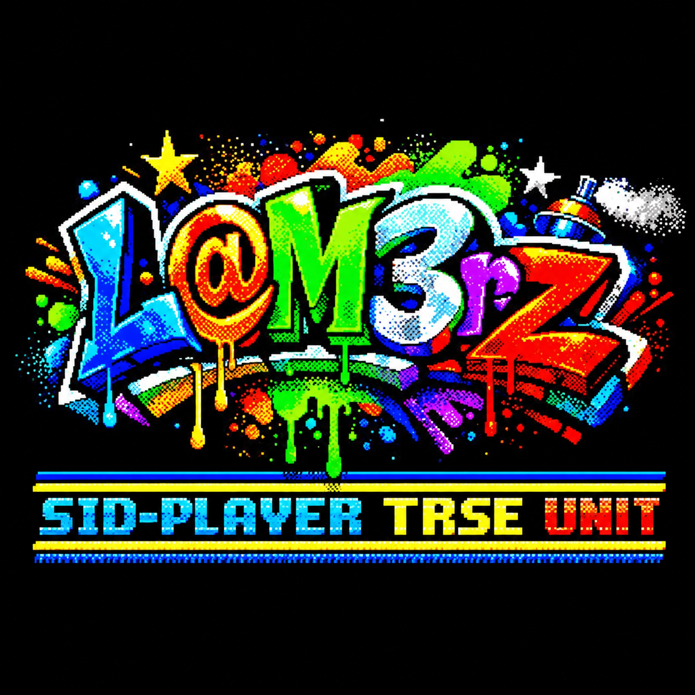

# SID2TVC TRSE Unit 1.0



**C64-es SID-zene háttérzenének Videoton TV-Computer játékokhoz – TRSE-unit.**

A [SIDSoftEMU](../SIDSoftEMU/) lejátszója unitként (`SID.tru`), ahogy a
GE: `@use "SID"`, és `SID::Start` / `SID::Play` / `SID::Stop`. A C64-es SID-zenét a TVC saját 4 bites hangkimenetén
játssza le, 3 hangon, SID-kártya nélkül, **miközben a játék fut**: a `SID::Play`-t képkockánként kell hívni a játék fő
hurkából.

## Mi kell hozzá

- **TRSE** – a unitot a programoddal együtt fordítja (Windows, Mac, Linux),
- **[SID2TVC Converter](../SID2TVC_Converter/)** (`sid2tvc` 1.4.1,
  letölthető Windowsra, Macre, Linuxra) – a PC elvégez mindent, a TVC csak lejátszik.

## A zene elkészítése

```
sid2tvc -b -s 1 zene.sid          SID → BIN: a SID fájlon belüli 1. dal (-a: az összes dal)
sid2tvc -b SONG1.STC              STC → BIN: egy kész .STC-ből (pl. a SIDSoftEMU dalai), a .STC mellé
sid2tvc -b -t 60 -s 1 zene.sid    ugyanez legfeljebb 1 percre, aztán elölről (kisebb dal)
```

Dalonként két fájl lesz, és a program kiírja a méretüket:

| Fájl | Mi | Hová kell tölteni |
|---|---|---|
| `SONG1_TAB.BIN` | a hangszín-táblák – csak amennyit a dal használ (1–14 × 256 byte) | laphatárra (`$xx00`) |
| `SONG1_DAL.BIN` | a kotta, áthelyezhető | bárhová |

A sid2tvc minden kapcsolója (és a SID → STC a SIDSoftEMU-hoz): [SID2TVC Converter](../SID2TVC_Converter/).

Kell még egy közös, 512 byte-os hely (laphatáron): ide a unit maga készíti el a zaj- és a szinttáblát. Több zenénél is
elég egy. Hogy mi hová kerül, azt a programozó dönti el a méretek alapján.

## Használat

```pascal
@use "GE"
@use "SID"

var
  ZeneTab : incbin("SONG1_TAB.BIN", $5000);    { laphatárra }
  ZeneDal : incbin("SONG1_DAL.BIN", $5E00);    { bárhová }

begin
  GE::Init(GE::DIRECT_TO_SCREEN);
  GE::SetMemory(GE::MEM_VID_ON);
  SID::Init(#ZeneDal, $50, $4E);               { a kotta, a táblák lapja, a közös 512 byte lapja ($4E00) }
  if (SID::Hiba = 0) then SID::Start();
  while (...) do
  begin
    SID::Sync();                               { vár a következő képkockára - a GE::WaitForSync helyett }
    { ... rajzolás, játéklogika ... }
    SID::Play();                               { a zene léptetése }
  end;
  SID::Stop();
end.
```

| Belépési pont | Mit csinál |
|---|---|
| `SID::Init(Dal, Lap, KozosLap)` | a kotta címe, a táblák lapja, a közös 512 byte lapja (a cím felső byte-ja). Ellenőriz, elkészíti a közös táblákat. Eredmény: `SID::Hiba` (0 = jó, 1 = nem `sid2tvc -b` kotta, 2 = a területek átfedik egymást) |
| `SID::Start()` | elindítja a zenét (saját hang-megszakítás, a kép aljához igazítva) |
| `SID::Sync()` | vár a következő képkockára (50/s) – a játék képkocka-szinkronja |
| `SID::Play()` | a zene léptetése; ha a játék lekésett egy-két képkockát, behozza (a tempó nem csúszik) |
| `SID::Stop()` | leállítás, minden vissza |

## Memória

A unit kódja kb. 1,6 KB (benne a 256 byte-os zajminta). Ehhez jön dalonként a `_TAB.BIN` és a `_DAL.BIN`, és egyszer a
közös 512 byte. Semmi nem marad a memóriában feleslegesen: minden a végleges helyén van, másolás nincs. A legtöbb helyet a
kotta viszi (egy teljes Last Ninja dal 22–48 KB) – játékba a `-t` kapcsolóval rövidebb zene készíthető.

## Amire figyelni kell

- A zene a gép idejének kb. **63%-át** viszi el, a többi a játéké – egyszerűbb játékokhoz való.
- Lejátszás alatt nem használható: `GE::WaitForSync` (helyette `SID::Sync`), a GE digi-hangja, ROM-hívás.
- A táblák (`Lap`, `KozosLap`) mindig látsszanak: az U0/U1-ben (`$0000–$7FFF`) bármilyen lapozás jó; ha az U3-ban
  (`$C000–$FFFF`) vannak, a lejátszás alatt `GE::MEM_48K_VID` kell. A kotta bárhol lehet.
- A részletek (regiszterek, megszakítás) a `SID.tru` elején.

## Tartalom

| Fájl | Mi ez |
|---|---|
| `SID.tru` | **a unit** – az elején a teljes leírás. Másold a programod mellé. |
| `SIDPelda.ras`, `SIDPelda.trse` | minta: egy négyzet pattog a képen, közben szól a zene (bármely gomb = vége) |
| `SIDPelda.cas`, `SIDPelda.dsk` | a lefordított minta: lemezen `LOAD "SIDPELDA"` |
| `resources/demo/DEMO_TAB.BIN`, `DEMO_DAL.BIN` | a minta zenéje: The Last Ninja 1. dal, 1 perc (eredeti: Ben Daglish & Anthony Lees, System 3, 1987) |
| `kepek/sidplayer.png` | a kiadás képe |
| `LICENSE` | MIT licenc |

Fordítás: TRSE-ben nyisd meg a `SIDPelda.trse`-t, és fordítsd le (Build). A TRSE a `SID.tru`-t a projekt mappájából
veszi.

## Hogyan működik?

A nehéz munkát a PC végzi: a sid2tvc lefuttatja a C64-es zenelejátszót, kiszámolja, hogyan szólna a SID (hullámformák,
szűrő, hangerő), és ebből dalonként egy kis hangszínpalettát és egy tömörített kottát készít. A TVC-nek már csak le kell
játszania: másodpercenként kb. 5000-szer összekeveri a három hangot, és kiküldi a 4 bites hangkimenetre; képkockánként
(50/s) a `SID::Play` olvassa tovább a kottát.

## English

**SID2TVC TRSE Unit** – a TRSE unit that plays C64 SID music on the Videoton TV-Computer's own 4-bit sound output
(3 voices, no SID card) **while your game runs**. Convert the tune with
[`sid2tvc`](../SID2TVC_Converter/) `-b` (`.sid` or `.STC` →
`SONG1_TAB.BIN`: the used tone tables, page-aligned; `SONG1_DAL.BIN`: the relocatable score, anywhere). Then:
`@use "SID"`, `SID::Init(#Score, TablePage, CommonPage)`, `SID::Start()`, every frame `SID::Sync()` (instead of
`GE::WaitForSync`) and `SID::Play()`, finally `SID::Stop()`. The music takes ~63% of the CPU. Full description (in
Hungarian) at the top of `SID.tru`. Example: `SIDPelda.ras` (`LOAD "SIDPELDA"`). Licence: MIT.

Forrás és fejlesztés: [SID-Player-for-TRSE](https://github.com/LaM3rzLG/SID-Player-for-TRSE). Letöltés egyben:
[SID2TVC TRSE Unit 1.0](https://github.com/LaM3rzLG/TVC-Programok/releases/tag/sid2tvc-trse-unit-1.0).

---
SID2TVC TRSE Unit – L@M3rZ (LaM3rzLG), 2026.
