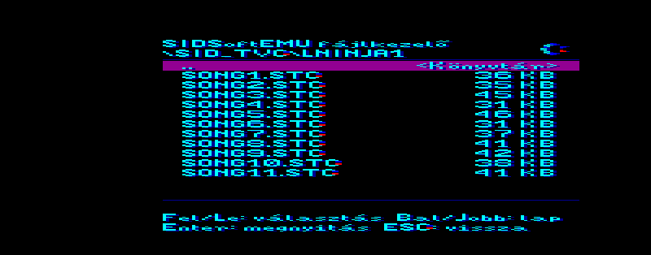
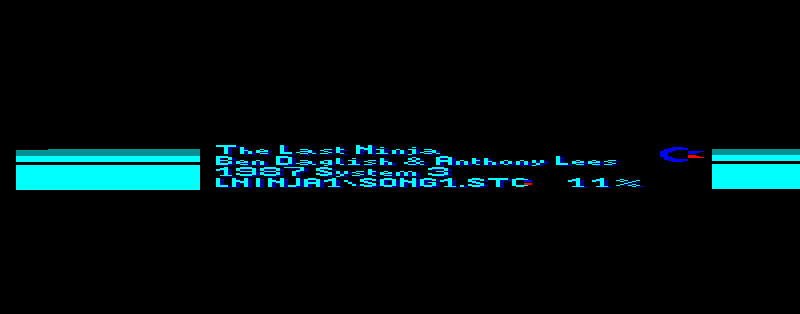

# SIDSoftEMU 1.1

**Commodore 64-es SID-zenék a Videoton TV-Computeren, SID-kártya nélkül.** A TVC saját, 4 bites hangkimenetén szól mind a
három SID-hang. A zenéket PC-n alakítjuk át, a TVC csak lejátssza őket.

## Mi van ebben a mappában

| Fájl | Mire való |
|---|---|
| `SIDTVC.CAS` | a program (SD-kártyára / NanoSD-re / pendrive-ra) |
| `SID_TVC/` | az összes zene (`.STC`): `LNINJA1` (11 dal), `LNINJA2` (12 dal) |
| `SIDTVC.dsk` | lemezkép (720 KB): a program + a Last Ninja 1 mind a 11 dala + a Last Ninja 2-ből 7 dal (1–6. és 9.) |

Mind a 23 dal nem fér el egy lemezen: a Last Ninja 2 7., 8., 10., 11. és 13. dala csak a `SID_TVC` mappában van.

## Mi kell hozzá

- **TV-Computer 64 KB memóriával** (a lejátszó a teljes 64 KB-ot használja),
- és az alábbiak egyike:
  - **lemezegység** (HBF-lemezkártya, VT-DOS 1.1 vagy 1.2),
  - **SD Dual** (VT-DOS),
  - **NanoSD**,
  - **TVC256k++** kártya (pendrive-val).

Emulátorban (freeTVC, ep128emu) lemezzel (VT-DOS 1.1 és 1.2), NanoSD-vel és TVC256k++-szal ki van próbálva, SD Duallal még
nem. **Valódi gépen még nem** - ha kipróbálod, szívesen veszem a visszajelzést.

## Indítás

### Lemezről (floppy vagy lemezkép)
1. Tedd be a `SIDTVC.dsk`-t.
2. BASIC-ben: `LOAD "SIDTVC"` - a program magától elindul.

### SD-kártyáról (SD Dual)
1. Másold a kártya gyökerébe a `SIDTVC.CAS`-t és a `SID_TVC` mappát (a szerkezete maradjon így:
   `SID_TVC\LNINJA1\SONG1.STC` ...).
2. BASIC-ben: `LOAD "SIDTVC"`.

### NanoSD-ről
1. Másold a kártya gyökerébe a `SIDTVC.CAS`-t és a `SID_TVC` mappát.
2. Bekapcsoláskor a NanoSD menüjében válaszd a `SIDTVC.CAS`-t, és nyomj Entert (vagy BASIC-ben `LOAD "SIDTVC"`).

### TVC256k++ kártyáról (pendrive)
1. Másold a pendrive gyökerébe a `SIDTVC.CAS`-t és a `SID_TVC` mappát.
2. BASIC-ben: `LOAD "SIDTVC"`. Ha lemezkártya is van a gépben, a TVC256k++ pendrive-ja az erősebb: a lista és a zenék is
   onnan jönnek.

## Kezelés

**Fájlkezelő**

| Gomb | Mit csinál |
|---|---|
| Fel / Le | választás (a lista görget, ha több fájl van, mint ami kifér) |
| Balra / Jobbra | lapozás |
| Enter | belépés a könyvtárba, ill. a `.STC` zene lejátszása |
| ESC | egy könyvtárral feljebb |
| ESC a legfelső könyvtárban | kilépés - „Biztosan kilépsz?” **I** = igen (vissza a BASIC-be, Graphics 4), **N** vagy ESC = nem |

**Lejátszás közben** bármely gomb = vissza a fájlkezelőbe.

A lejátszás alatt a képernyő közepén látszik a zene címe, szerzője, kiadása és a fájl neve, mellette hogy hol tart a dal
(0-100 %), a szöveg két oldalán pedig a keret a zene ritmusára villog. A dalok a végük után az ismétlődő résztől szólnak
tovább, amíg meg nem állítod.

## A zenék

| Mappa | Zene | Szerző | Kiadás |
|---|---|---|---|
| `LNINJA1` | The Last Ninja | Ben Daglish & Anthony Lees | 1987 System 3 |
| `LNINJA2` | Last Ninja 2 | Matt Gray | 1988 System 3 |

A zenék szerzői jogai a szerzőké és a kiadóé. Az eredeti `.sid` fájlok forrása a
[High Voltage SID Collection (HVSC)](https://www.hvsc.c64.org/). A Last Ninja 2 12. dala túl nagy, ezért kimaradt.

**Saját zenék:** bármely `.sid` fájlt a [`sid2tvc`](../sid2tvc/) átalakítóval lehet `.STC`-vé alakítani (Windows, macOS,
Linux; Windowson elég a `.sid`-et a programra húzni). Ingyenes `.sid` zenék: [HVSC](https://www.hvsc.c64.org/).

## Hogyan működik (röviden)

- A PC a `.sid` fájl 6502-es lejátszóját futtatja, és képkockánként (50/s) rögzíti a SID-regisztereket.
- Ebből kiszámolja a valódi SID-hangot (hullámformák, szűrő, burkoló), és dalonként 14 hangszín-táblát készít.
- A TVC egy 5008 Hz-es megszakításban keveri a három hangot (hangonként 16 hangerőszint), és a 4 bites hangkimenetre küldi.
- A `.STC` fájl (1.3-as formátum) tartalmazza a dal címét, szerzőjét, hosszát, a hangszín-táblákat és a tömörített zenét
  (legfeljebb kb. 50 KB).

Részletesen: [MUKODES.md](MUKODES.md).

**Saját programba:** a lejátszó önállóan, forrással és leírással: [SIDSoftEMU / SIDLEJATSZO](https://github.com/LaM3rzLG/SIDSoftEMU/tree/main/SIDLEJATSZO).

## Változások

**1.1** (2026-11-04)
- VT-DOS 1.1-es lemezkártyával is listáz (eddig „hiba: 255”).
- TVC256k++ kártya (pendrive) támogatása (eddig „hiba: 233”).
- Gyorsabb fájllista: egy sornyi görgetés kb. 0,1 s (eddig kb. 0,45 s).
- A program neve `SIDTVC.CAS`; egyetlen lemezkép, `SIDTVC.dsk`.

**1.0** (2026-11-02) - az első kiadás.

---
SIDSoftEMU - L@M3rZ (LaM3rzLG), 2026.
