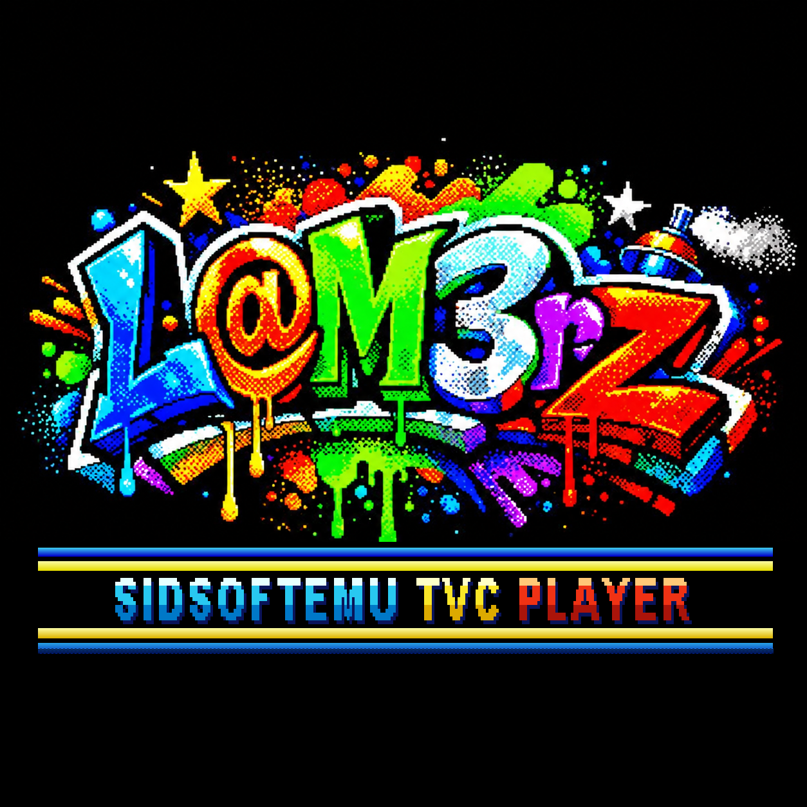

# SIDSoftEMU 1.1

**Commodore 64-es SID-zenék a Videoton TV-Computeren, SID-kártya nélkül.**

A TVC saját, 4 bites hangkimenetén szól mind a három SID-hang. A zenéket PC-n alakítjuk át a
[SID2TVC Converter](../SID2TVC_Converter/)-rel, a TVC csak lejátssza őket: fájlkezelővel, a dal címével, szerzőjével, és
hogy hol tart a dal.

## Mi kell hozzá

- **TV-Computer 64 KB memóriával** (a lejátszó a teljes 64 KB-ot használja),
- és az alábbiak egyike:
  - **lemezegység** (HBF-lemezkártya, VT-DOS 1.1 vagy 1.2),
  - **SD Dual** (VT-DOS),
  - **NanoSD**,
  - **TVC256k++** kártya (pendrive-val).

Emulátorban (freeTVC, ep128emu) lemezzel (VT-DOS 1.1 és 1.2), NanoSD-vel és TVC256k++-szal ki van próbálva, SD Duallal
még nem. **Valódi gépen még nem** – ha kipróbálod, szívesen veszem a visszajelzést.

## Indítás

| Honnan | Mit kell tenni |
|---|---|
| **Lemezről** (floppy vagy lemezkép) | tedd be a `SIDTVC.dsk`-t, BASIC-ben `LOAD "SIDTVC"` – a program magától elindul |
| **SD-kártyáról** (SD Dual) | a kártya gyökerébe a `SIDTVC.CAS` és a `SID_TVC` mappa (változatlan szerkezetben: `SID_TVC\LNINJA1\SONG1.STC` …), aztán `LOAD "SIDTVC"` |
| **NanoSD-ről** | a kártya gyökerébe a `SIDTVC.CAS` és a `SID_TVC` mappa; bekapcsoláskor a NanoSD menüjében Enter a `SIDTVC.CAS`-on (vagy `LOAD "SIDTVC"`) |
| **TVC256k++ kártyáról** (pendrive) | a pendrive gyökerébe a `SIDTVC.CAS` és a `SID_TVC` mappa, aztán `LOAD "SIDTVC"`. Ha lemezkártya is van a gépben, a TVC256k++ az erősebb: a lista és a zenék is onnan jönnek |

## Kezelés

| Gomb | Mit csinál |
|---|---|
| Fel / Le | választás (a lista görget, ha több fájl van, mint ami kifér) |
| Balra / Jobbra | lapozás |
| Enter | belépés a könyvtárba, ill. a `.STC` zene lejátszása |
| ESC | egy könyvtárral feljebb |
| ESC a legfelső könyvtárban | kilépés – „Biztosan kilépsz?” **I** = igen (vissza a BASIC-be, Graphics 4), **N** vagy ESC = nem |
| bármely gomb lejátszás közben | vissza a fájlkezelőbe |

A lejátszás alatt a képernyő közepén látszik a zene címe, szerzője, kiadása és a fájl neve, mellette hogy hol tart a
dal (0–100 %), a szöveg két oldalán pedig a keret a zene ritmusára villog. A dalok a végük után az ismétlődő résztől
szólnak tovább, amíg meg nem állítod.

## A zenék

| Mappa | Zene | Szerző | Kiadás |
|---|---|---|---|
| `LNINJA1` | The Last Ninja (11 dal) | Ben Daglish & Anthony Lees | 1987 System 3 |
| `LNINJA2` | Last Ninja 2 (12 dal) | Matt Gray | 1988 System 3 |

A zenék szerzői jogai a szerzőké és a kiadóé; az eredeti `.sid` fájlok forrása a
[High Voltage SID Collection (HVSC)](https://www.hvsc.c64.org/). A Last Ninja 2 12. dala túl nagy, ezért kimaradt.

**Saját zenék:** bármely `.sid` fájl `.STC`-vé alakítható a [SID2TVC Converter](../SID2TVC_Converter/)-rel (Windows,
macOS, Linux; Windowson elég a `.sid`-et a programra húzni). Ingyenes `.sid` zenék: [HVSC](https://www.hvsc.c64.org/).

**Saját programba / játékba:** a lejátszó TRSE-unitként: [SID2TVC TRSE Unit](../SID2TVC_TRSE_Unit/).

## Tartalom

| Fájl | Mi ez |
|---|---|
| `SIDTVC.CAS` | a program (SD-kártyára / NanoSD-re / pendrive-ra) |
| `SIDTVC.dsk` | lemezkép (720 KB): a program + a Last Ninja 1 mind a 11 dala + a Last Ninja 2-ből 7 dal (1–6. és 9.) |
| `SID_TVC/` | az összes zene (`.STC`): `LNINJA1` (11 dal), `LNINJA2` (12 dal) |
| `MUKODES.md` | hogyan működik, részletesen |
| `kepek/` | képek |

Mind a 23 dal nem fér el egy lemezen: a Last Ninja 2 7., 8., 10., 11. és 13. dala csak a `SID_TVC` mappában van.

## Hogyan működik?

A nehéz munkát a PC végzi: a sid2tvc lefuttatja a C64-es zenelejátszót, kiszámolja, hogyan szólna a SID (hullámformák,
szűrő, hangerő), és ebből dalonként egy kis hangszínpalettát és egy tömörített kottát készít (`.STC`, legfeljebb kb.
50 KB). A TVC-nek már csak le kell játszania: másodpercenként kb. 5000-szer összekeveri a három hangot (hangonként 16
hangerőszint), és kiküldi a 4 bites hangkimenetre. Részletesen: [MUKODES.md](MUKODES.md).

## Változások

**1.1** (2026-11-04)
- VT-DOS 1.1-es lemezkártyával is listáz (eddig „hiba: 255”).
- TVC256k++ kártya (pendrive) támogatása (eddig „hiba: 233”).
- Gyorsabb fájllista: egy sornyi görgetés kb. 0,1 s (eddig kb. 0,45 s).
- A program neve `SIDTVC.CAS`; egyetlen lemezkép, `SIDTVC.dsk`.

**1.0** (2026-11-02) – az első kiadás.

## English

**SIDSoftEMU** – plays Commodore 64 SID music on the Videoton TV-Computer's own 4-bit sound output, no SID card needed.
Needs a 64 KB TVC with a floppy (VT-DOS 1.1/1.2), SD Dual, NanoSD or TVC256k++; start with `LOAD "SIDTVC"`. Comes with
the Last Ninja 1–2 tunes; convert your own with the [SID2TVC Converter](../SID2TVC_Converter/).

---
SIDSoftEMU – L@M3rZ (LaM3rzLG), 2026.
